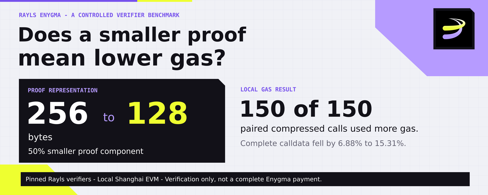
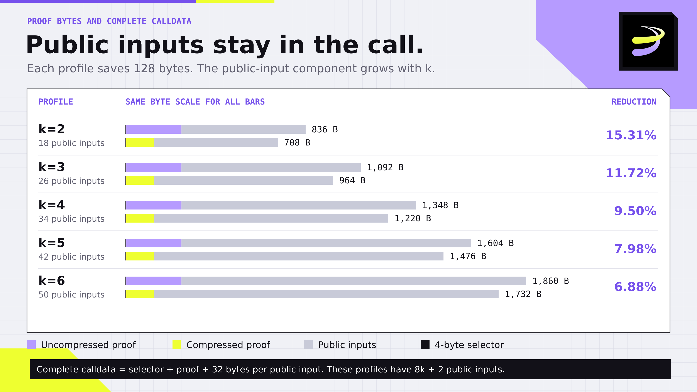
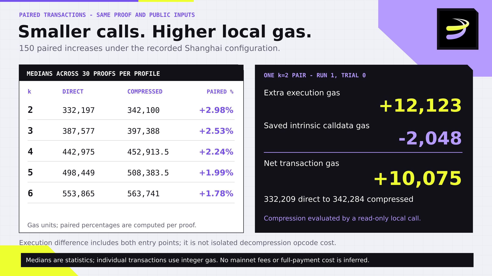
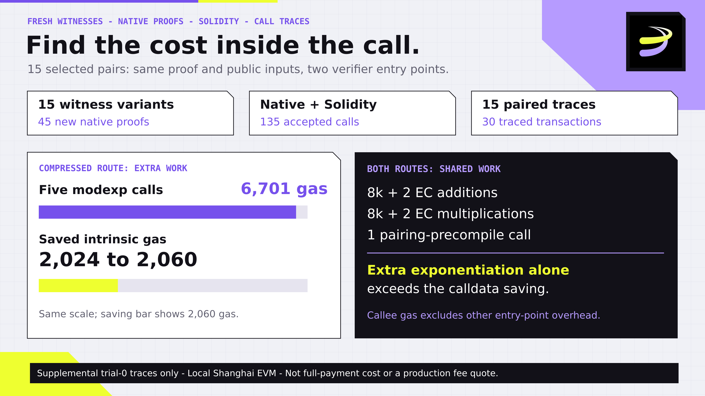
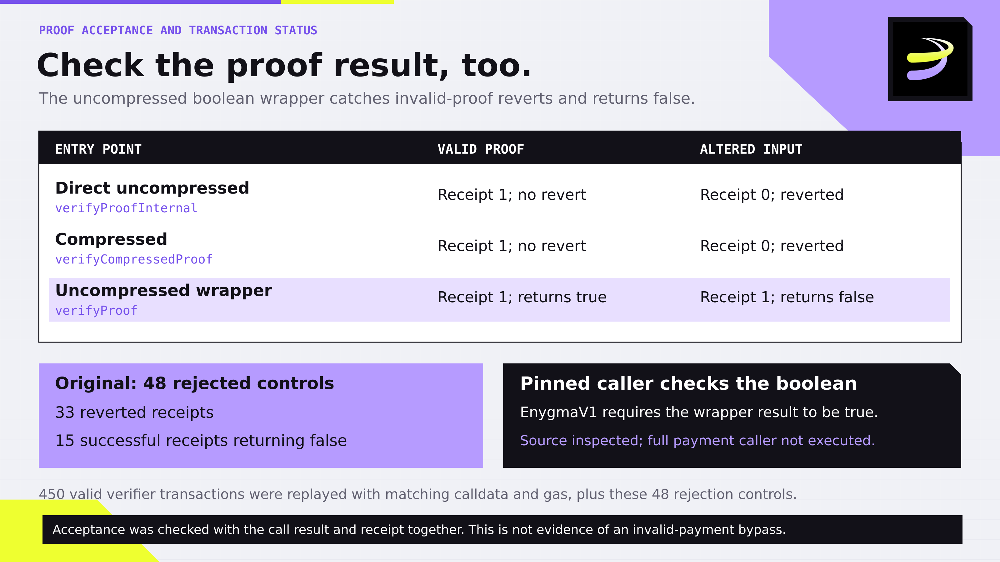

# Does Compressing a ZK Proof Save Gas? A Rayls Enygma Experiment

A smaller zero-knowledge proof can still cost more to verify.

I tested published Rayls Enygma verifiers with the same proofs in compressed and uncompressed form. Compression halved the proof component, from 256 to 128 bytes. Complete calldata fell by 6.88% to 15.31%, while transaction gas increased in all 150 original paired comparisons.

I then generated 45 new proofs across different synthetic witness cases and passed those proofs through Solidity. All 45 additional pairs showed the same direction. Execution traces helped explain the result: in 15 selected pairs, the compressed route's extra modular-exponentiation calls alone cost more than the calldata gas saved.

These are local verifier measurements under a fixed Shanghai EVM configuration. They are not Rayls mainnet fees or complete private-payment costs.

## What question does this answer?

Rayls documents Enygma as a way to move value between Sovereign chains, with a proof checked on the Private Network Hub. Its complete flow also involves commitments, encrypted messages, relayers and settlement logic. [1]

I isolated one component: for the same valid proof and public inputs, how do the available verifier entry points compare?

The five profiles use k=2 through k=6 participant positions. Some positions can receive zero value. Here, k is a circuit parameter, not a count of client payments, and this experiment does not quantify anonymity or privacy strength.

The source pins were:

- Circuit and published-key artifacts: `be20e7fb1fcbafccbc5450d0b5900e27c2e53788`. [2]
- Solidity verifier contracts: `ed8863885c8ed5d5d317d47a34c063907192687a`. [3]

The benchmark used Anvil 1.3.1, local chain ID 31337, Shanghai rules, and Solidity 0.8.30 with optimizer enabled for 200 runs. No live Rayls transaction was signed or submitted.

## The proof halves; the public inputs stay

A BN254 Groth16 proof has two G1 points and one G2 point. The representation tested here occupies 256 bytes uncompressed or 128 bytes compressed. Recovering omitted coordinates requires computation. This size-versus-computation trade-off is established engineering, described by the verifier-template author, Remco Bloemen. [4]

Enygma's public-input component remains in both calls. These profiles have 8k + 2 public inputs, each occupying 32 ABI bytes.

Complete calldata therefore contains a four-byte function selector, the proof representation and those public inputs.

| Profile | Public inputs | Uncompressed calldata | Compressed calldata | Reduction |
| --- | ---: | ---: | ---: | ---: |
| k=2 | 18 | 836 bytes | 708 bytes | 15.31% |
| k=3 | 26 | 1,092 bytes | 964 bytes | 11.72% |
| k=4 | 34 | 1,348 bytes | 1,220 bytes | 9.50% |
| k=5 | 42 | 1,604 bytes | 1,476 bytes | 7.98% |
| k=6 | 50 | 1,860 bytes | 1,732 bytes | 6.88% |

Every profile saves exactly 128 calldata bytes. As the public inputs grow, that fixed saving becomes a smaller fraction of the call.

A 50% smaller proof component therefore does not imply a 50% smaller transaction.

*Original profiles: full calldata includes the public inputs; each pair saves 128 bytes.*

## Measure both routes using the same proof

The original synthetic fixture gave the sender 100 test units and transferred 30 to one recipient. Other participant positions received zero.

Three fresh Go processes each generated two excluded warmup proofs and ten recorded proofs per profile. The result was 150 recorded proofs, each verified natively before the Solidity stage.

Each proof was then submitted through three entry points:

- `verifyProofInternal`: direct uncompressed verification.
- `verifyCompressedProof`: compressed verification.
- `verifyProof`: the uncompressed boolean wrapper.

Across three fresh local EVM processes, this produced 450 accepted verification transactions and 150 paired compressed/direct comparisons.

Gas came from mined transaction receipts. The table shows medians across 30 proofs per profile.

| Profile | Direct uncompressed gas | Compressed gas | Median paired increase |
| --- | ---: | ---: | ---: |
| k=2 | 332,197 | 342,100 | 2.98% |
| k=3 | 387,577 | 397,388 | 2.53% |
| k=4 | 442,975 | 452,913.5 | 2.24% |
| k=5 | 498,449 | 508,383.5 | 1.99% |
| k=6 | 553,865 | 563,741 | 1.78% |

The percentage is calculated for each matched proof before taking the median. It is not obtained by subtracting the two independently calculated column medians. A fractional median averages two integer observations; transactions themselves consume integer gas.

**All 150 original pairs used more gas through the compressed route.** That route also exceeded the boolean wrapper in every original comparison.

These are randomized repetitions of one fixture per profile, not 150 different financial workflows.

## Reconcile where the gas went

Under the tested Shanghai rules, intrinsic transaction gas includes 21,000 gas plus four gas per zero calldata byte and 16 per nonzero byte. [5]

For original run 1, k=2, trial 0:

- Direct uncompressed transaction: **332,209 gas**.
- Compressed transaction: **342,284 gas**.
- Intrinsic calldata saving: **2,048 gas**.
- Additional execution gas excluding intrinsic gas: **12,123**.

The accounting reconciles:

**12,123 extra execution − 2,048 saved intrinsic = 10,075 extra total gas.**

The script checks this identity for every pair. Compression was obtained through a read-only local call; these measurements exclude a separate transaction to compress the proof.

The execution difference includes both entry points. It should not be labelled an isolated opcode-level cost of decompression.

*Original 150-pair benchmark: per-profile medians and one exact gas reconciliation.*

## Does the result survive different witness cases?

The original data left a useful question: would changing the synthetic witness change the conclusion?

I added three cases for each of the five profiles:

- **Move the sender:** the last participant position sends one of its 1,000 units to position zero.
- **Spend the full balance:** position zero sends all 100 units to the last position.
- **Pay all available recipients:** position zero sends 60 units, divided equally among the other k−1 positions. At k=2 this is still one recipient; k=3 through k=6 exercise multiple positive recipients.

That produced 15 witness variants. Three randomized proofs per variant gave 45 new proofs. Each was generated and verified natively, then passed through all three pinned Solidity routes: **135 accepted verification transactions**.

**All 45 supplemental compressed/direct pairs also increased gas**, by 9,615 to 10,175 gas in this captured set. Alternate trials reversed the route submission order.

These results are reported separately. They do not change the original medians or turn synthetic verifier cases into completed Enygma payments.

## Trace the extra computation

I captured call traces for trial zero of each supplemental variant: 15 direct/compressed pairs, or 30 traced transactions.

Both routes made the same number of elliptic-curve addition and multiplication calls, plus one pairing-precompile call. The compressed route added **five calls to the modular-exponentiation precompile at address 0x05**. [6]

Those five calls consumed **6,701 gas inside the precompile** in every selected compressed trace. The paired intrinsic calldata savings ranged from **2,024 to 2,060 gas**.

For these traced pairs, the extra exponentiation cost alone already exceeded the calldata saving. Other execution differences remained on top of it.

This explains the direction with execution evidence. The 6,701 figure is a traced callee cost, not the full cost of decompression. The trace finding covers the declared 15-pair selection, not every proof in the study.

*Supplemental trial-zero selection: 15 paired traces. The exponentiation figure is callee gas, not full decompression cost.*

## Check proof acceptance separately from receipt status

Valid-proof measurements used published proving and verifying keys. The five rebuilt circuit hashes and constraint counts matched the ceremony manifest; selected key and generated-verifier artifacts matched its release 2. The deployed contracts came from the pinned contracts repository, and observed runtime bytes matched the compiled verifiers. [2][3]

These are artifact-consistency checks. They do not independently replay the ceremony or establish deletion of secret setup material.

The original study included 48 rejection controls. The supplement added 60: 45 altered-public-input calls and 15 calls using a proof from another circuit profile.

All supplemental controls rejected the proof. Forty transaction receipts reverted. Twenty wrapper receipts succeeded while the verification call returned false. The original controls showed the same distinction: 33 reverted receipts and 15 successful receipts accompanying false.

**A successful wrapper transaction is not, by itself, proof acceptance.** The pinned EnygmaV1 caller selects the uncompressed verifyProof wrapper and requires its boolean result to be true. The compressed entry point is an available route compared here; this study does not establish its use by a production payment path. The full caller was inspected in source, not executed, and the results do not establish an invalid-payment bypass.

Ten additional invalid witnesses were rejected by the native constraint solver: insufficient sender balance and a nonzero-sum transfer, once each per profile. These are circuit controls, not mined transactions.

*Original rejection controls: receipt status and proof-verification result are distinct. The supplement repeats this distinction with its separate 60 controls.*

## When could fewer bytes become worthwhile?

The result depends on pricing as well as representation.

As an explicit hypothetical model, add the same extra charge d to every calldata byte, on top of the measured Shanghai transaction cost. For the original example, the compressed-minus-direct difference becomes:

**10,075 − 128d.**

That pair would break even at about **78.71 additional gas-equivalent units per calldata byte**.

This is arithmetic using measured inputs, not a repriced-chain experiment or a quote for Rayls or a rollup. Actual data-fee rules may distinguish byte values, compress batches differently or add other costs.

The useful decision is therefore to compare complete calldata and verification work under the intended execution and data-pricing rules.

## Reproduce the evidence

The public evidence repository is [david-enygma-proof-compression-study](https://github.com/davidvnvn276/david-enygma-proof-compression-study).

The package preserves the original 55 files and their unchanged manifest, plus the review replay, supplemental proofs, raw receipts, raw call traces, source pins, calculations and executable harnesses.

The README offers three verification levels:

1. **Saved records:** `python3 verify_all.py` checks file identities, input/receipt bindings and calculations. It does not execute proof verification.
2. **Fresh original execution:** `reproduce.py --evm --native`, with the documented tools, replays the original Solidity experiment and performs a separate 50-proof native regeneration check.
3. **Fresh variant execution:** `supplemental/reproduce.py` generates new variant proofs and passes those very proofs through Solidity.

The original replay reproduced all 150 paired calldata/gas results. A fresh randomized supplement need not reproduce identical proof bytes or gas for every sample; it should reproduce validity, declared coverage and circuit identities. Its own paired costs are recalculated.

A GitHub Actions workflow runs these stages and retains logs and results. Its existence is not a claim of a successful public run: readers should inspect the actual run and commit. The captured local results do not establish that every public repository revision passed CI.

Original measurements were captured on 27 October 2026; the supplemental checks were captured on 29 October. Go 1.26.2, gnark 0.14.0 and gnark-crypto 0.19.2 were used. Native timings are shared-machine context and do not support production performance claims.

The conclusion is bounded: **for these pinned Rayls Enygma verifiers, compression saved bytes while increasing local verification gas.** Fresh witness variants and selected execution traces strengthened the explanation. Full payment cost still requires the rest of the payment path.

## Sources

- [1] [Rayls: How Enygma works](https://docs.rayls.com/docs/how-enygma-works)
- [2] [Pinned circuit source](https://github.com/raylsnetwork/rayls-sovereign-gnark-api/tree/be20e7fb1fcbafccbc5450d0b5900e27c2e53788) and [ceremony manifest](https://github.com/raylsnetwork/rayls-sovereign-gnark-api/blob/be20e7fb1fcbafccbc5450d0b5900e27c2e53788/ceremony/manifest.json)
- [3] [Pinned Rayls Enygma contracts](https://github.com/raylsnetwork/rayls-sovereign-contracts/tree/ed8863885c8ed5d5d317d47a34c063907192687a/src/rayls-protocol/Enygma/Enygma-Payments)
- [4] [Remco Bloemen: BN254 Point Compression for L2s](https://xn--2-umb.com/23/bn254-compression/)
- [5] [EIP-2028: Transaction data gas cost reduction](https://eips.ethereum.org/EIPS/eip-2028)
- [6] [EIP-198: Modular exponentiation](https://eips.ethereum.org/EIPS/eip-198) and [EIP-196: Curve-operation precompile addresses](https://eips.ethereum.org/EIPS/eip-196)
